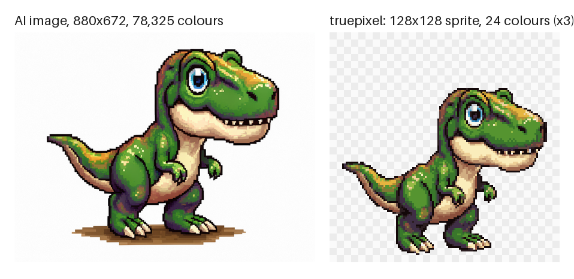
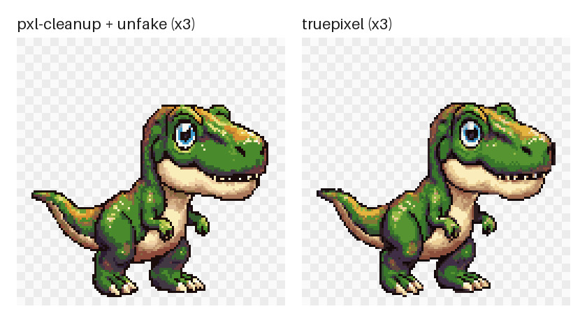
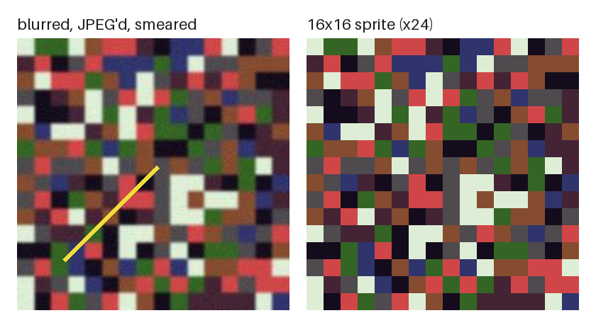
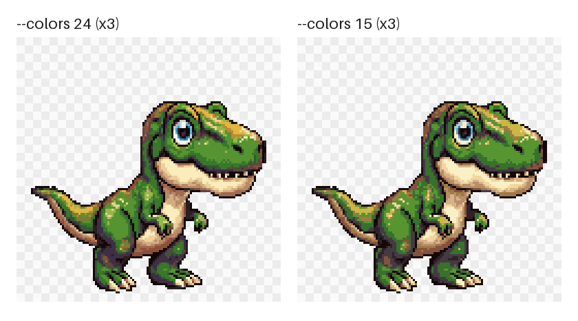

<div align="center">

# truepixel

**Turn AI "pixel art" into a real, transparent, game-ready sprite with one command.**

Image models draw something that looks like pixel art from across the room: uneven blocks, blur inside every "pixel", tens of thousands of colours, a white background. [pixel-snap](https://github.com/klavdiy-core/pixel-snap) finds the true pixel grid; [pxl-cleanup](https://github.com/alvincrespo/pxl-cleanup) removes the background and puts the sprite on a canvas. truepixel does both, in one file, with numpy and Pillow only.

Works with **Claude Code** and **Codex**.

 



<sub>Real output of <code>python truepixel.py examples/trex.jpg --scale 6</code>. The sprite is shown at 3x on a checkerboard so you can see it is transparent.</sub>

</div>

## Quick start
```bash
git clone https://github.com/Dodai0419/truepixel && cd truepixel
pip install numpy pillow
python truepixel.py --demo
```
```
trex.jpg: 880x672 (sprite area 680x558) -> 114x93 sprite (pixel 6), 24 colours, 1257 mixed cells
  wrote dist\trex.sprite.png and dist\trex.preview.png
messy.png: 233x233 -> 16x16 sprite (pixel 14.546), 8 colours, 5 mixed cells
  wrote dist\messy.sprite.png and dist\messy.preview.png
```
On your own image:
```bash
python truepixel.py my-dragon.png --out-dir sprites
```

## Gallery
Every image below is unedited output of `truepixel.py` on a file in `examples/`.

### Same job as pxl-cleanup, without scipy or unfake
`python truepixel.py examples/trex.jpg --scale 6` next to the `4_final.png` that pxl-cleanup committed for the same image and the same settings (pixel size 6, 24 colours, 128 px canvas, 4 px margin). The silhouettes overlap with an IoU of 0.955 (tested in `tests/`). pxl-cleanup rebuilds the grid with the [unfake](https://pypi.org/project/unfake/) package, which pulls in OpenCV; truepixel uses pixel-snap's grid code instead.



### A blurred, JPEG'd sprite with a smear, back to 16x16
`python truepixel.py examples/messy.png --palette examples/palette.hex --keep-background --canvas 0`

The pixel size is 14.546 px, not a whole number, and truepixel finds it. After the same 8x upscale that pixel-snap's README uses, the output is pixel-identical to pixel-snap's own `clean.png` for this file (tested). 5 cells are reported as mixed: the yellow smear crosses them.



### Fewer colours
`--colors 15` gives a 16-bit console look (15 colours plus transparency). Colours are picked by a deterministic k-means, so the same input always gives the same sprite.



## How it works
| Stage | What happens | From |
|---|---|---|
| 1. Background | Near-white pixels (and brown "ground" pixels in the bottom 20 %) that connect to the image border are made transparent. The sprite's dark outline stops the fill, so light areas inside it (teeth, eyes, a pale belly) stay. A 2 px light JPEG halo is swallowed. Then it crops to the sprite. | pxl-cleanup, rewritten without scipy |
| 2. Grid | The true pixel size and offset come from the edge spectrum of the image, fractional sizes included; smooth (bilinear, bicubic) upscales are read from where the colour ramps bend. A photo is recognised as "no grid" instead of getting an invented one. | pixel-snap |
| 3. Cells | One colour per cell, read from the cell centre where no blur leaks in. Cells that hold two colours are counted as mixed. Edge cells ignore the removed background, so it does not tint the outline. | pixel-snap, batched |
| 4. Colours | `--colors N` (k-means) or `--palette file.hex` / GIMP `.gpl`. | pixel-snap |
| 5. Canvas | Bottom-centred on a square transparent canvas, feet `--margin` px above the bottom, so a whole roster lines up. | pxl-cleanup |

## The problem
- AI pixel art cannot go into a game as it is: a 114x93 sprite arrives as an 880x672 picture with 78,325 colours and a white box around it.
- pixel-snap fixes the grid but leaves the background; pxl-cleanup removes the background but needs scipy plus unfake (and with it OpenCV) for the grid.
- pixel-snap reads each cell in a Python loop: on an 880x672 image at pixel size 6 that is 16,464 `np.median` calls.

## The solution
| Idea | Fixes |
|------|-------|
| **One command, image to sprite** | background, grid, colours and canvas in one run, with a before/after preview |
| **Same results as the sources** | pixel-identical to pixel-snap's committed example and to pxl-cleanup's committed background-removal output |
| **Cells in batches** | cells come in a few window sizes, so each size gets one batched median: 19-44x faster on the T-Rex, same output |
| **Two dependencies** | numpy and Pillow; no scipy, no unfake, no OpenCV |

## Options
| Option | Default | Use |
|---|---|---|
| `--scale N` | detect | the width of one fake pixel in the source; set it when the output says `WARNING no pixel grid` |
| `--colors N` | 24 | palette size; `0` keeps every cell's colour |
| `--palette FILE` | | snap to a `.hex` or GIMP `.gpl` palette |
| `--canvas N` | 128 | square canvas; `0` = tight crop |
| `--margin N` | 4 | empty pixels under the feet |
| `--ground-band F` | 0.80 | brown pixels below this share of the height count as ground; `1.0` keeps them |
| `--keep-background` | off | do not remove the background (also skipped when the image already has transparency) |
| `--out-dir DIR` | next to the input | where `<name>.sprite.png` and `<name>.preview.png` go |

## Use with Claude Code
```bash
/plugin marketplace add Dodai0419/truepixel
/plugin install truepixel@truepixel
```
Then ask: *"Make a real 128 px sprite out of dragon.png with 16 colours."* The skill tells the agent to run truepixel, react to the grid warning with `--scale`, and look at the preview before calling it done.

## Use with Codex (ChatGPT)
```bash
git clone https://github.com/Dodai0419/truepixel && cp -r truepixel/skills/* ~/.codex/skills/
```
Or copy `AGENTS.md` to your project root.

## Benchmarks
Windows 11, Python 3.11.1, numpy 2.4.6, Pillow 12.3.0, a busy desktop machine (timings swing, so ranges of two runs are given).

| | pixel-snap | pxl-cleanup | truepixel |
|-|-|-|-|
| `messy.png` with `palette.hex` (pixel-snap's README example) | committed `clean.png` | | pixel-identical (`tests/`) |
| `trex.jpg` background removal | | committed `1_nobg.png` | pixel-identical (`tests/`) |
| `trex.jpg` final sprite, pixel size 6, 24 colours | | committed `4_final.png` | silhouette IoU 0.955; colours differ (different grid and k-means code) |
| cell step, `messy.png` (256 cells), median of 5 | 43-47 ms | | 6.3-6.6 ms |
| cell step, `trex.jpg` at pixel size 6 (16,464 cells), median of 5 | 1,463-3,501 ms | | 77-80 ms |
| cell step, `trex.jpg` at pixel size 4 (36,960 cells), median of 5 | 3,559-3,714 ms | | 90-106 ms |
| whole CLI run on `trex.jpg --scale 6`, median of 5 | | not measured | 1.75 s (1.51-2.08 s) |
| dependencies | numpy, Pillow | numpy, Pillow, scipy, unfake (+ opencv-python) | numpy, Pillow |
| lines of code | 427 | 196 (+ unfake) | 443, including the preview image and the CLI |

The pixel-snap column runs pixel-snap 0.5.2's cell loop, copied unchanged into `bench/bench_snap.py`, on the same arrays, and checks the two outputs are identical. Run it with `python bench/bench_snap.py`. The upstream packages themselves were not executed here; the "committed" rows compare against images those repos ship.

## Known limits
- Grid detection is pixel-snap's. It does not find the grid of every AI image: on `trex.jpg` it reports `no pixel grid` and you pass `--scale 6`, as pxl-cleanup does by default.
- Background removal only handles a plain light background (and brown ground). A busy scene needs a real matting tool first.
- Mixed cells are counted, not repaired.

## Inspired by
- [klavdiy-core/pixel-snap](https://github.com/klavdiy-core/pixel-snap) — grid detection, the photo check, cell snapping, palettes and k-means (MIT, code adapted; the cell loop is batched here).
- [alvincrespo/pxl-cleanup](https://github.com/alvincrespo/pxl-cleanup) — the background flood fill, the ground band, the JPEG-halo step and canvas placement (MIT, rewritten without scipy).

## Roadmap
- [ ] Repair mixed cells by voting with their neighbours
- [ ] Sprite sheets: one shared palette and grid across many frames
- [ ] Detect the pixel size from the outline width when the spectrum finds nothing

## License
MIT. Code adapted from pixel-snap (MIT, Copyright (c) 2026 klavdiy-core) and pxl-cleanup (MIT, Copyright (c) 2026 Alvin Crespo); example images from both. See `LICENSE`.
